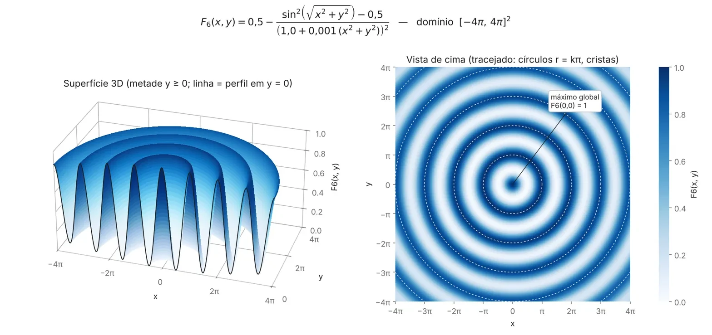

# AGF6 — Algoritmo Genético para maximizar a função F6

Implementação em C# (.NET 8) de um **Algoritmo Genético (AG) clássico** — cromossomo binário, seleção por roleta, cruzamento de um ponto, mutação bit a bit e elitismo — aplicado à função de teste **F6 de Schaffer**.

---

## 1. O problema

Queremos encontrar o par `(x, y)` que **maximiza**:

$$
F_6(x, y) = 0{,}5 - \frac{\sin^2\left(\sqrt{x^2 + y^2}\right) - 0{,}5}{\left(1{,}0 + 0{,}001\,(x^2 + y^2)\right)^2}
\qquad x, y \in [-100,\ 100]
$$



*O gráfico mostra a região central `[-4π, 4π]²` para facilitar a visualização; o programa busca em `[-100, 100]²`.*

O que o gráfico revela:

- O **máximo global** fica em `(0, 0)`, com `F6 = 1`.
- Em volta dele há **anéis concêntricos** (cristas em raio `r = π, 2π, 3π, …`) que são **máximos locais** quase tão bons quanto o global: o 1º anel vale ≈ **0,9903** e o 2º ≈ **0,9628**.
- Entre os anéis há vales profundos. Um método que “só sobe a ladeira” fica preso no primeiro anel que encontrar.

Por isso a F6 é usada como teste: ela mede se o AG consegue **escapar dos máximos locais** e chegar ao centro.

---

## 2. Como compilar e executar

Pré-requisito: [.NET SDK 8](https://dotnet.microsoft.com/download).

```bash
cd AGF6
```

```bash
dotnet build
```

Há três formas de rodar:

| Comando | O que faz |
|---|---|
| `dotnet run` | Uma execução com semente aleatória (resultado muda a cada vez). |
| `dotnet run -- 42` | Uma execução com **semente fixa** (resultado sempre igual — bom para comparar). |
| `dotnet run -- experimento 30` | Roda o AG **30 vezes** (sementes 1 a 30) e informa quantas chegaram ao ótimo global. |

Também é possível abrir `AGF6.sln` no Visual Studio e executar com **F5**.

---

## 3. Como analisar os resultados

### 3.1 Execução única (`dotnet run -- 42`)

A saída tem quatro blocos:

**a) Parâmetros usados**
```
População: 100 | Gerações: 400 | Cruzamento: 65% | Mutação: 0,8% por bit | Elite: 1
```

**b) Exemplo de indivíduo** — mostra como 44 bits viram um ponto `(x, y)` e uma nota:
```
Cromossomo (x | y): 1001001101001000101100 | 0111010111000110111000
Decodificado:       x =   76,906962 y =  -30,092604 F6 = 0,49808884
```

**c) Evolução** — impressa a cada 20 gerações:
```
Geração |    Melhor F6 |     Média F6 |  x do melhor |  y do melhor
-------------------------------------------------------------------
      0 |   0,68388411 |   0,49707794 |     8,398702 |    23,561984
     20 |   0,96030341 |   0,57859175 |    -3,759695 |     4,961992
    ...
    400 |   0,96277592 |   0,81375477 |    -3,943087 |     4,884125
```

| Coluna | Como ler |
|---|---|
| **Melhor F6** | Nota do melhor indivíduo da geração. Graças ao elitismo, **nunca diminui**. |
| **Média F6** | Nota média da população. Subindo = a população está convergindo. Oscila por causa da mutação. |
| **x / y do melhor** | Onde está o melhor indivíduo. Quanto mais perto de `(0, 0)`, melhor. |

**d) Melhor solução** — compara com o ótimo teórico:
```
x =   -3,943087 y =    4,884125 F6 = 0,96277592
Ótimo teórico: x = 0, y = 0, F6 = 1
Diferença para o ótimo: 3,722E-002
```

**Como interpretar o valor final de F6:**

| Melhor F6 | Significado | Raio `√(x²+y²)` |
|---|---|---|
| ≈ **1,0000** | Achou o **máximo global** | ≈ 0 |
| ≈ **0,9903** | Preso no **1º anel** (máximo local) | ≈ π (3,14) |
| ≈ **0,9628** | Preso no **2º anel** (máximo local) | ≈ 2π (6,28) |

No exemplo com semente 42, `√(3,94² + 4,88²) ≈ 6,28`: o AG ficou preso no 2º anel. Note também que `x` e `y` “pulam” de sinal ao longo das gerações sem a nota mudar — o AG está andando **ao longo do anel**, onde todos os pontos valem o mesmo.

> Mesmo quando acerta, o resultado aparece como `x = 0,000024` e não `0`: com 22 bits o passo da grade é `200 / (2²² − 1) ≈ 0,0000477`, e o zero exato fica entre dois pontos da grade.

### 3.2 Experimento (`dotnet run -- experimento 30`)

Como o AG é aleatório, **uma execução só não diz muito**. O modo experimento roda várias vezes e classifica cada uma:

```
Semente   1: x =    4,452540 y =   -4,424645 F6 = 0,96277592 -> Preso em máximo local
Semente   2: x =   -0,000024 y =   -0,000024 F6 = 1,00000000 -> Ótimo global
Semente   3: x =    1,280380 y =   -2,865434 F6 = 0,99028409 -> Preso em máximo local
...
Chegou ao ótimo global em 22 de 30 execuções (73%).
Média do melhor F6: 0,996492
```

- Uma execução conta como **ótimo global** se `F6 > 0,999`.
- A **taxa de sucesso** (aqui, 73%) é a principal métrica para comparar configurações: altere um valor em `Parametros.cs`, rode o experimento de novo e compare.

---

## 4. Como o algoritmo funciona — passo a passo

### Visão geral

```
Criar 100 indivíduos aleatórios
Repetir 400 vezes (gerações):
    1. Copiar o melhor indivíduo direto para a próxima geração (elitismo)
    2. Enquanto a nova população não tiver 100 indivíduos:
         a. Escolher um pai e uma mãe pela roleta
         b. Cruzar os dois → 2 filhos
         c. Aplicar mutação nos filhos
         d. Colocar os filhos na nova população
    3. A nova população substitui a antiga
Devolver o melhor indivíduo visto em todas as gerações
```

### 4.1 O indivíduo e o cromossomo (`Individuo.cs`)

Cada indivíduo é uma **sequência de 44 bits** (`true`/`false`):

```
|←—— 22 bits para x ——→|←—— 22 bits para y ——→|
 1001001101001000101100 0111010111000110111000
```

Para transformar bits em um número real, o programa faz 3 passos:

1. **Gray → binário.** Os bits estão em *código Gray* (binário refletido). Regra: o 1º bit é copiado; cada bit seguinte é *invertido* em relação ao anterior se o bit Gray for 1, ou *repetido* se for 0.
   - Por que Gray? Nele, números vizinhos diferem em **apenas 1 bit**. Assim, uma mutação pequena gera um passo pequeno. No binário comum, ir de 7 (`0111`) para 8 (`1000`) exige trocar 4 bits.
2. **Binário → inteiro.** Leitura normal da esquerda para a direita: valor entre `0` e `2²² − 1 = 4.194.303`.
3. **Inteiro → real.** Regra de três para o intervalo `[-100, 100]`:

   ```
   valor = -100 + (inteiro / 4.194.303) × 200
   ```

A **aptidão** (nota) do indivíduo é simplesmente `F6(x, y)`. Quanto maior, melhor.

### 4.2 População inicial

São criados **100 indivíduos** com bits sorteados ao acaso (cara ou coroa para cada bit). Eles ficam espalhados por todo o quadrado `[-100, 100]²`.

### 4.3 Seleção por roleta (`Selecionar`)

Imagine uma roleta em que **cada indivíduo ocupa uma fatia proporcional à sua nota**. Quem tem nota maior ganha uma fatia maior e, portanto, mais chance de ser sorteado — mas todos têm alguma chance.

Passo a passo:

1. Soma as notas de todos: `S = F6₁ + F6₂ + … + F6₁₀₀`.
2. Sorteia um número entre `0` e `S` (onde a “bolinha” para).
3. Percorre a população somando as notas, uma a uma.
4. O primeiro indivíduo em que a soma acumulada **passa** do número sorteado é o escolhido.

Exemplo com 4 indivíduos:

| Indivíduo | Nota | Fatia acumulada |
|---|---|---|
| A | 0,2 | 0,0 – 0,2 |
| B | 0,5 | 0,2 – 0,7 |
| C | 0,1 | 0,7 – 0,8 |
| D | 0,8 | 0,8 – 1,6 |

Se o sorteio der `0,95`, cai na fatia de **D**. D tem 50% de chance (`0,8 / 1,6`); C, apenas 6%.

A roleta é chamada duas vezes: uma para o **pai**, outra para a **mãe** (o mesmo indivíduo pode sair duas vezes).

### 4.4 Cruzamento de um ponto (`Cruzar`)

1. Sorteia um número: com **65%** de chance o cruzamento acontece; nos outros 35% os filhos são cópias exatas dos pais.
2. Se acontecer, sorteia um **ponto de corte** entre 1 e 43.
3. Cada filho fica com o começo de um pai e o final do outro:

```
Ponto de corte:          ↓
Pai:     1 1 0 1 0 1 | 1 0 0 1
Mãe:     0 0 1 1 1 0 | 0 1 1 0
                       ↓
Filho 1: 1 1 0 1 0 1 | 0 1 1 0   (início do pai + final da mãe)
Filho 2: 0 0 1 1 1 0 | 1 0 0 1   (início da mãe + final do pai)
```

A ideia é **combinar partes boas** de dois indivíduos bons. Como o corte pode cair no meio do `x` ou no meio do `y`, os filhos podem herdar o `x` de um pai e o `y` do outro, ou misturas dentro de uma mesma variável.

### 4.5 Mutação bit a bit (`Mutar`)

Para **cada um dos 44 bits** de cada filho, sorteia-se um número: com **0,8%** de chance o bit é invertido (`0 → 1` ou `1 → 0`).

```
Antes:  1 1 0 1 0 1 0 1 1 0
Depois: 1 1 0 1 1 1 0 1 1 0
                ↑ bit invertido
```

Em média, cerca de **1 bit muda a cada 3 filhos** (`44 × 0,008 ≈ 0,35`). A mutação é o que **traz novidade**: permite ao AG explorar pontos que nenhum pai tinha e, com sorte, “pular” de um anel para outro mais perto do centro.

### 4.6 Elitismo

Antes de gerar os filhos, o **melhor indivíduo** da geração atual é copiado **sem alteração** para a próxima. Isso garante que a melhor solução encontrada nunca se perde — por isso a coluna *Melhor F6* nunca cai.

### 4.7 Substituição e fim

Os filhos formam a nova população (100 indivíduos, incluindo a elite), que **substitui inteiramente** a anterior. O ciclo se repete por **400 gerações**. Ao final, o programa devolve o melhor indivíduo visto em toda a execução.

---

## 5. Parâmetros (`Parametros.cs`)

| Constante | Valor | Papel |
|---|---|---|
| `limiteInferior` / `limiteSuperior` | -100 / 100 | Intervalo de busca para `x` e `y` |
| `bitsPorVariavel` | 22 | Precisão de cada variável (passo ≈ 0,0000477) |
| `tamanhoCromossomo` | 44 | 22 bits de `x` + 22 bits de `y` |
| `tamanhoPopulacao` | 100 | Indivíduos por geração |
| `numeroGeracoes` | 400 | Quantas gerações o AG roda |
| `taxaCruzamento` | 0,65 | Chance de um casal cruzar |
| `taxaMutacao` | 0,008 | Chance de **cada bit** ser invertido |
| `qtdeElite` | 1 | Quantos melhores passam direto |
| `intervaloImpressao` | 20 | A cada quantas gerações imprimir |

Para experimentar, altere um valor, recompile e rode `dotnet run -- experimento 30` para comparar a taxa de sucesso.

---

## 6. Estrutura do projeto

```
AGF6/
├── AGF6.sln
├── docs/
│   └── funcao-f6.webp       Gráfico da função
└── AGF6/
    ├── Program.cs           Ponto de entrada: execução única ou experimento
    ├── AlgoritmoGenetico.cs Laço de gerações, roleta, cruzamento, mutação, elitismo
    ├── Individuo.cs         Cromossomo, decodificação Gray → real, aptidão
    ├── FuncaoF6.cs          A função F6
    └── Parametros.cs        Todas as configurações do AG
```
